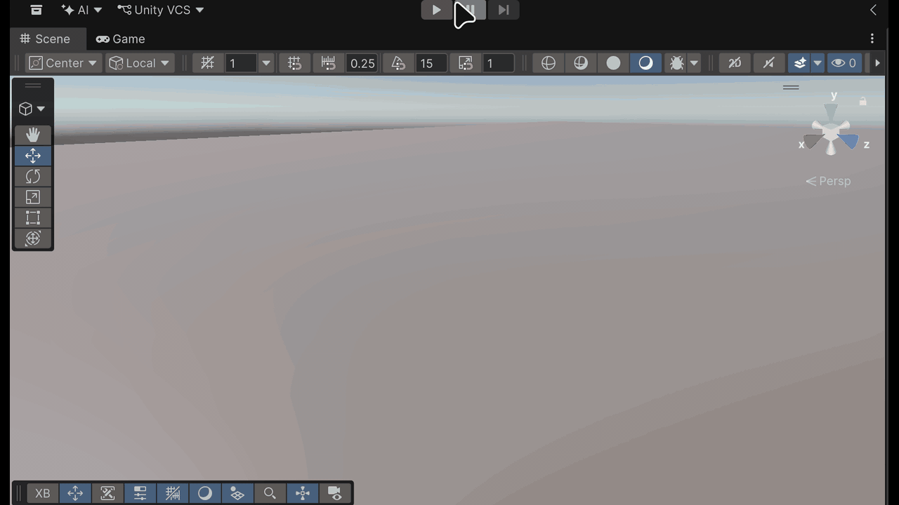

# Práctica 6

Scripts: `./Scripts/cambiarColor.cs`, `./Scripts/actualizarUI.cs`

## Configuración

Instalé XR Plugin Management, OpenXR y XR Interaction Toolkit con sus Starter Assets. Activé OpenXR en Standalone con los perfiles de los mandos de Quest. Para probar usé el simulador genérico del XR Interaction Toolkit en lugar del de Meta.

Como decía, quité la Main Camera y puse el XR Origin de los Starter Assets, que ya trae la cámara, los mandos y la locomoción.

## Ejercicio

### Agrega en la escena un cubo, una esfera y un objeto de la asset store que elijas sobre un plano, cada uno de ellos a diferentes distancias. El cubo y esfera serán Ray Interactor que cambian de color al seleccionarlo. El objeto de la asset store será un Direct Interactor que actualiza la UI al agarrarlo.

El cubo y la esfera están lejos y se cogen con el rayo del mando. Al seleccionarlos se ponen de otro color y al soltarlos vuelven al suyo. El método está enganchado a los eventos Select Entered y Select Exited del XR Grab Interactable.

El objeto de la Asset Store es un yunque, porque me parecía gracioso cogerlo con una mano. Está al alcance de la mano y se coge de cerca. Al principio un texto en un Canvas en World Space dice "Prueba a agarrar el yunque", y cada vez que lo agarras cambia a "El yunque fue agarrado N veces".

Los tres tienen Collider, Rigidbody y XR Grab Interactable.
